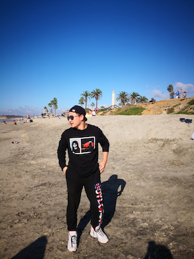

<!--  -->

<!-- Photo credit: [Chao Zhang](http://chaozhang.org/) -->

## Contact
Email: xiusichen [AT] cse.cuhk.edu.hk; xiusi0721 [AT] gmail.com; xiusic [AT] illinois.edu    
Office: 4211 Siebel Center for Computer Science, 201 N. Goodwin Ave, Urbana, IL 61801    

<!-- ## What's New

 -->

## Bio
Starting Fall 2027, I will be a tenure-track Assistant Professor in the [Department of Computer Science and Engineering](https://www.cse.cuhk.edu.hk/) at the [Chinese University of Hong Kong (CUHK)](https://www.cuhk.edu.hk/english/index.html). I am actively looking for students and collaborators. If you are interested, please send me an email titled [PhD/Mphil/RA + Year] along with your CV and transcript. 

I am a postdoctoral research fellow in [Blender Lab](https://blender.cs.illinois.edu/index.html) at [University of Illinois Urbana-Champaign](https://siebelschool.illinois.edu/) (UIUC), working with Prof. [Heng Ji](https://blender.cs.illinois.edu/hengji.html).

I completed my Ph.D. in Computer Science at [University of California, Los Angeles](https://www.cs.ucla.edu/) (UCLA), advised by Prof. [Wei Wang](http://web.cs.ucla.edu/~weiwang/). Before UCLA, I got my B.S. in Computer Science from [Peking University](https://cs.pku.edu.cn/English/Home.htm), advised by Prof. [Jun Gao](https://cs.pku.edu.cn/info/1214/1977.htm). During Ph.D., I spent two summers at Amazon Science.
<!-- I also worked with Prof. [ChengXiang Zhai](http://czhai.cs.illinois.edu/) at UIUC for a wonderful summer. -->

I played for Peking University Men's Basketball Varsity Team, Division II, during college.

My CV is available [here](CV.pdf).

## Research Interests
My ultimate research goal is to build automated language agents that can assist human in a variety of domains. To achieve this goal, I worked on:    
*    **Large Language Models**, especially low-resource LLM reasoning ([_ACL'24_](https://arxiv.org/pdf/2310.05007.pdf), [_ICML'24a_](https://arxiv.org/pdf/2402.04624), [_ICLR'25a_](https://arxiv.org/pdf/2410.00487), [_COLM'24_](https://arxiv.org/pdf/2401.13849), [_SDM'23_](https://epubs.siam.org/doi/epdf/10.1137/1.9781611977653.ch102), [_WSDM'24_](https://arxiv.org/pdf/2402.04616.pdf)) and alignment ([_ICLR'26_](https://arxiv.org/pdf/2505.02387), [_NAACL'24_](https://arxiv.org/pdf/2403.18341.pdf));    
*    **NLP Applications**, especially in AI for Science, IR and recommendation ([_EMNLP'24_](https://arxiv.org/pdf/2406.10833), [_ICML'24b_](https://arxiv.org/pdf/2310.07815), [_CIKM'22a_](papers/cikm_b.pdf), [_Amazon Reviews'23 dataset_](https://arxiv.org/pdf/2403.03952));    
*    **Complex Dynamics Modeling and Decision Making**, especially the planning tasks in sports domain ([_CIKM'22b_](papers/cikm_a.pdf), [_CIKM'24_](https://arxiv.org/pdf/2306.04090.pdf), [_ICLR'25b_](https://arxiv.org/pdf/2408.10635), [_Arxiv'24_](https://arxiv.org/pdf/2412.13549), [_Arxiv'25_](https://arxiv.org/pdf/2502.11435)).

**To junior Ph.D./master/undergraduate students:** If you would like to chat about your career plan or research ideas related to my research interests, please email me to schedule a meeting. I will dedicate 30 minutes to each meeting weekly.

### Invited Talks
May 2026&nbsp;&nbsp;&nbsp;&nbsp;&nbsp;Guest Lecture at Northwestern University    
Apr 2026&nbsp;&nbsp;&nbsp;&nbsp;&nbsp;Seminar Talk at Texas A&M University    
Feb 2026&nbsp;&nbsp;&nbsp;&nbsp;&nbsp;Seminar Talk at University of Wisconsin - Madison    
Dec 2025&nbsp;&nbsp;&nbsp;&nbsp;&nbsp;Seminar Talk at Peking University    
Nov 2025&nbsp;&nbsp;&nbsp;&nbsp;&nbsp;Seminar Talk at The Chinese University of Hong Kong    
Nov 2025&nbsp;&nbsp;&nbsp;&nbsp;&nbsp;Seminar Talk at Northeastern University    
Oct 2025&nbsp;&nbsp;&nbsp;&nbsp;&nbsp;&nbsp;Guest Lecture at CS6320 Natural Language Processing, UT Dallas    
Sept 2025&nbsp;&nbsp;&nbsp;&nbsp;Invited Talk at ByteDance Seed Research    
Aug  2025&nbsp;&nbsp;&nbsp;&nbsp;&nbsp;Keynote talk at [KDD 2025 Large Language Model For E-Commerce Workshop](https://kdd2025llm4ecommerce.github.io/schedule/)    
Aug  2025&nbsp;&nbsp;&nbsp;&nbsp;&nbsp;Talk at [DARPA ITM](https://www.darpa.mil/research/programs/in-the-moment) August 2025 PI Meeting    
May  2025&nbsp;&nbsp;&nbsp;&nbsp;&nbsp;Tutorial at NAACL 2025    
Oct  2024&nbsp;&nbsp;&nbsp;&nbsp;&nbsp;&nbsp;Talk at UIUC-NLP    
July 2024&nbsp;&nbsp;&nbsp;&nbsp;&nbsp;Invited Talk at University of California, San Diego    

## Selected Publications [[Full List](https://scholar.google.com/citations?hl=en&user=JqGAil4AAAAJ&view_op=list_works&sortby=pubdate)]
#### ("\*" marks equal contribution.)

[RM-R1: Reward Modeling as Reasoning](https://arxiv.org/pdf/2505.02387)    
**Xiusi Chen**\*, Gaotang Li\*, Ziqi Wang\*, Bowen Jin, Cheng Qian, Yu Wang, Hongru Wang, Yu Zhang, Denghui Zhang, Tong Zhang, Hanghang Tong, Heng Ji    
_ICLR 2026_    
\[[code](https://github.com/RM-R1-UIUC/RM-R1)\]\[[project page](https://rm-r1-uiuc.github.io/rmr1-site/)\]\[[dataset & model checkpoints](https://huggingface.co/collections/gaotang/rm-r1-681128cdab932701cad844c8)\]    
 170+ stars on GitHub    
 Featured in the  <a href="https://github.com/verl-project/verl?tab=readme-ov-file#awesome-projects-built-with-verl" target="_blank" style="color:#ad1457; text-decoration:none;" class="bold-link"> <b> Verl GitHub repo </b> </a>

[DecisionFlow: Advancing Large Language Model as Principled Decision Maker](https://arxiv.org/pdf/2505.21397)    
**Xiusi Chen**\*, Shanyong Wang\*, Cheng Qian\*, Hongru Wang\*, Peixuan Han, Heng Ji   
_EMNLP 2025 Findings_    
\[[code](https://github.com/xiusic/DecisionFlow)\]\[[project page](https://decisionflow-uiuc.github.io/)\]    

[Beyond Log Likelihood: Probability-Based Objectives for Supervised Fine-Tuning across the Model Capability Continuum](https://arxiv.org/pdf/2510.00526)    
Gaotang Li\*, Ruizhong Qiu\*, **Xiusi Chen**\*, Heng Ji, Hanghang Tong    
_ICML 2026 (spotlight)_    
\[[code](https://github.com/GaotangLi/Beyond-Log-Likelihood)\]    

[MinPrompt: Graph-based Minimal Prompt Data Augmentation for Few-shot Question Answering](https://arxiv.org/pdf/2310.05007.pdf)    
**Xiusi Chen**, Jyun-Yu Jiang, Wei-Cheng Chang, Cho-Jui Hsieh, Hsiang-Fu Yu and Wei Wang     
_ACL 2024_     
\[[code](https://github.com/xiusic/MinPrompt)\]

[IterAlign: Iterative Constitutional Alignment of Large Language Models](https://arxiv.org/pdf/2403.18341.pdf)    
**Xiusi Chen**, Hongzhi Wen, Sreyashi Nag, Chen Luo, Qingyu Yin, Ruirui Li, Zheng Li, Wei Wang    
_NAACL 2024_     
\[[code](https://github.com/xiusic/IterAlign)\]

[A Comprehensive Survey of Scientific Large Language Models and Their Applications in Scientific Discovery](https://arxiv.org/pdf/2406.10833)    
Yu Zhang\*, **Xiusi Chen**\*, Bowen Jin\*, Sheng Wang, Shuiwang Ji, Wei Wang, Jiawei Han    
_EMNLP 2024_     
\[[project page](https://github.com/yuzhimanhua/Awesome-Scientific-Language-Models)\]    
660+ stars on GitHub

[Beyond Answers: Transferring Reasoning Capabilities to Smaller LLMs Using Multi-Teacher Knowledge Distillation](https://arxiv.org/pdf/2402.04616.pdf)    
Yijun Tian\*, Yikun Han\*, **Xiusi Chen**\*, Wei Wang, Nitesh V. Chawla    
_WSDM 2025_    
\[[code](https://github.com/YikunHan42/TinyLLM)\]

[PlayBest: Professional Basketball Player Behavior Synthesis via Planning with Diffusion](https://arxiv.org/pdf/2306.04090.pdf)    
**Xiusi Chen**, Wei-Yao Wang, Ziniu Hu, David Reynoso, Kun Jin, Mingyan Liu, P. Jeffrey Brantingham, Wei Wang     
_CIKM 2024_    
\[[code](https://github.com/xiusic/diffuser_bball)\]

[Gotta: Generative Few-shot Question Answering by Prompt-based Cloze Data Augmentation](https://epubs.siam.org/doi/epdf/10.1137/1.9781611977653.ch102)    
**Xiusi Chen**, Yu Zhang, Jinliang Deng, Jyun-Yu Jiang and Wei Wang  
_SDM 2023_     
\[[code](https://github.com/xiusic/Gotta)\]     
Best Poster Award (Honorable Mention), Regular Paper

[Scalable Graph Representation Learning via Locality-Sensitive Hashing](papers/cikm_b.pdf)   
**Xiusi Chen**, Jyun-Yu Jiang and Wei Wang    
_CIKM 2022_    
\[[code]()\]

[ReLiable: Offline Reinforcement Learning for Tactical Strategies in Professional Basketball Games](papers/cikm_a.pdf)       
**Xiusi Chen**, Jyun-Yu Jiang, Kun Jin, Yichao Zhou, Mingyan Liu, Jefferey Brantingham and Wei Wang    
_CIKM 2022_    
\[[code]()\]

[ToolRL: Reward is All Tool Learning Needs](https://arxiv.org/pdf/2504.13958)    
Cheng Qian, Emre Can Acikgoz, Qi He, Hongru Wang, **Xiusi Chen**, Dilek Hakkani-Tür, Gokhan Tur, Heng Ji    
_NeurIPS 2025_    
\[[code](https://github.com/qiancheng0/ToolRL)\]    
 520+ stars on GitHub    

<!--
[OTC: Optimal Tool Calls via Reinforcement Learning](https://arxiv.org/pdf/2504.14870)    
Hongru Wang, Cheng Qian, Wanjun Zhong, **Xiusi Chen**, Jiahao Qiu, Shijue Huang, Bowen Jin, Mengdi Wang, Kam-Fai Wong, Heng Ji    
_ArXiv 2025_    
\[[code]()\]
-->

[EscapeBench: Pushing Language Models to Think Outside the Box](https://arxiv.org/pdf/2412.13549)    
Cheng Qian, Peixuan Han, Qinyu Luo, Bingxiang He, **Xiusi Chen**, Yuji Zhang, Hongyi Du, Jiarui Yao, Xiaocheng Yang, Denghui Zhang, Yunzhu Li, Heng Ji    
_ACL 2025_    
\[[code](https://github.com/qiancheng0/EscapeBench)\]

[Strategist: Learning Strategic Skills by LLMs via Bi-Level Tree Search](https://arxiv.org/pdf/2408.10635)    
Jonathan Light, Min Cai, Weiqin Chen, Guanzhi Wang, **Xiusi Chen**, Wei Cheng, Yisong Yue, Ziniu Hu    
_ICLR 2025_    
\[[code](https://github.com/jonathanmli/Avalon-LLM)\]\[[project page](https://llm-strategist.github.io/)\]    
Covered by [State of AI Report 2024](https://docs.google.com/presentation/d/1GmZmoWOa2O92BPrncRcTKa15xvQGhq7g4I4hJSNlC0M/edit#slide=id.g2d35a16f27e_0_24), published by [Air Street Capital](https://www.stateof.ai/2024).    

[Chain-of-Factors Paper-Reviewer Matching](https://arxiv.org/pdf/2310.14483)    
Yu Zhang, Yanzhen Shen, SeongKu Kang, **Xiusi Chen**, Bowen Jin, Jiawei Han    
_WWW 2025_    
\[[code](https://github.com/yuzhimanhua/CoF)\]

[Language Models as Semantic Indexers](https://arxiv.org/pdf/2310.07815)    
Bowen Jin, Hansi Zeng, Guoyin Wang, **Xiusi Chen**, Tianxin Wei, Ruirui Li, Zhengyang Wang, Zheng Li, Yang Li, Hanqing Lu, Suhang Wang, Jiawei Han, Xianfeng Tang    
_ICML 2024_    
\[[code](https://github.com/PeterGriffinJin/LMIndexer)\]

[TPD: Enhancing Student Language Model Reasoning via Principle Discovery and Guidance](https://arxiv.org/pdf/2401.13849)    
Haorui Wang, Rongzhi Zhang, Yinghao Li, Lingkai Kong, Yuchen Zhuang, **Xiusi Chen**, Chao Zhang    
_COLM 2024_    

[Bridging Language and Items for Retrieval and Recommendation](https://arxiv.org/pdf/2403.03952) (**Amazon Reviews 2023**)    
Yupeng Hou\*, Jiacheng Li\*, Zhankui He, An Yan, **Xiusi Chen**, Julian McAuley    
_ACL 2026_    
\[[code](https://github.com/hyp1231/AmazonReviews2023)\]\[[website](https://amazon-reviews-2023.github.io/)\]\[[huggingface](https://huggingface.co/datasets/McAuley-Lab/Amazon-Reviews-2023)\]    
300+ stars on Github    
1.2M+ downloads on HuggingFace

## Academic Service
**Workshop Organizer**    
[_ACL 2026 workshop SURGeLLM: Structured Understanding, Retrieval, and Generation in LLMs era_](https://surgellm.github.io/acl2026/)    
[_KDD 2025 workshop on Structured Knowledge for Large Language Models_](https://sknowllm.github.io/index.html)    
Co-organizer of [UIUC-NLP Seminar series](https://docs.google.com/spreadsheets/d/1LEzop096QH4OOwHE-5eqyuG9d5a8nCiILZhhYlJhXIE/edit?usp=sharing)    

**Conference Program Committee**        
**Area Chair**        
_ACL Rolling Review_    
**Reviewer**        
_ICML 2023-2025; NeurIPS 2022-2026; ICLR 2022-2026; AAAI 2021-2024; IJCAI-ECAI 2022-2023;_    
_KDD 2020-2025; WSDM 2022-2025; WWW 2024;_    

**Journal Reviewer**    
_IEEE Transactions on Big Data (TBD)_.

## Honors and Awards
**2023**  [Best Poster Award (Honorable Mention)](images/bpahm.pdf), _SDM 2023_   
**2023**  SIAM Student Travel Award, _SIAM_   
**2021, 2022**  SIGIR Student Travel Grant, _ACM SIGIR_    
**2016, 2017**  Graduate Student Acedemic Scholarship, _Peking University_     
**2016**  Leo KoGuan Scholarshop, _Peking University_    
**2016**  Merit Student, _Peking University_     
**2014**  3rd Place of 17th Chinese University Basketball Association (CUBA) Championships, Beijing Division, _Federation of University Sports of China_   

## Miscellaneous
I played for [Peking University Men's Basketball varsity team](images/pkumbb.jpeg), division II.    
I was a registered swimming athlete in China during high school.    
I was born and raised in Changsha, Hunan, China.

<!-- 
## Links
[❤️](https://sites.google.com/site/ruihanwu14/)    
[Google Scholar](https://scholar.google.com/citations?user=JqGAil4AAAAJ)    
[Github](https://github.com/xiusic)    
[DBLP](https://dblp.org/pid/210/1049)    
[Twitter](https://twitter.com/XtremSup)    
[LinkedIn](https://www.linkedin.com/in/xiusi-chen-53180583/)    
-->

